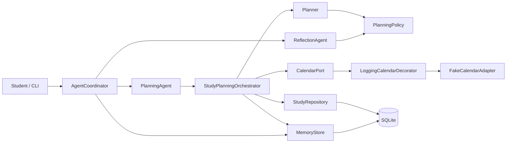

# Week 11 - Integrated Agent Architecture

The diagram keeps the existing Week 5-10 application core while adding two specialist roles and coordination. Dependencies are supplied at the outer composition root (`run.py`).

## Responsibility boundaries
- The **coordinator** controls the order of specialist roles, not calendar or database details.
- The **planning role** delegates to the existing orchestrator rather than copying scheduling logic.
- The **reflection role** checks coverage, session duration and unique slots. It does not modify the plan.
- **CalendarPort**, **MemoryStore** and **StudyRepository** remain abstraction boundaries.
- The **Factory** constructs the provider and the **Decorator** adds logging at composition time.

## Evidence
See `run.py`, `agent/coordinator.py`, `agent/reflection_agent.py`, and the successful trace in `testing.md`.
