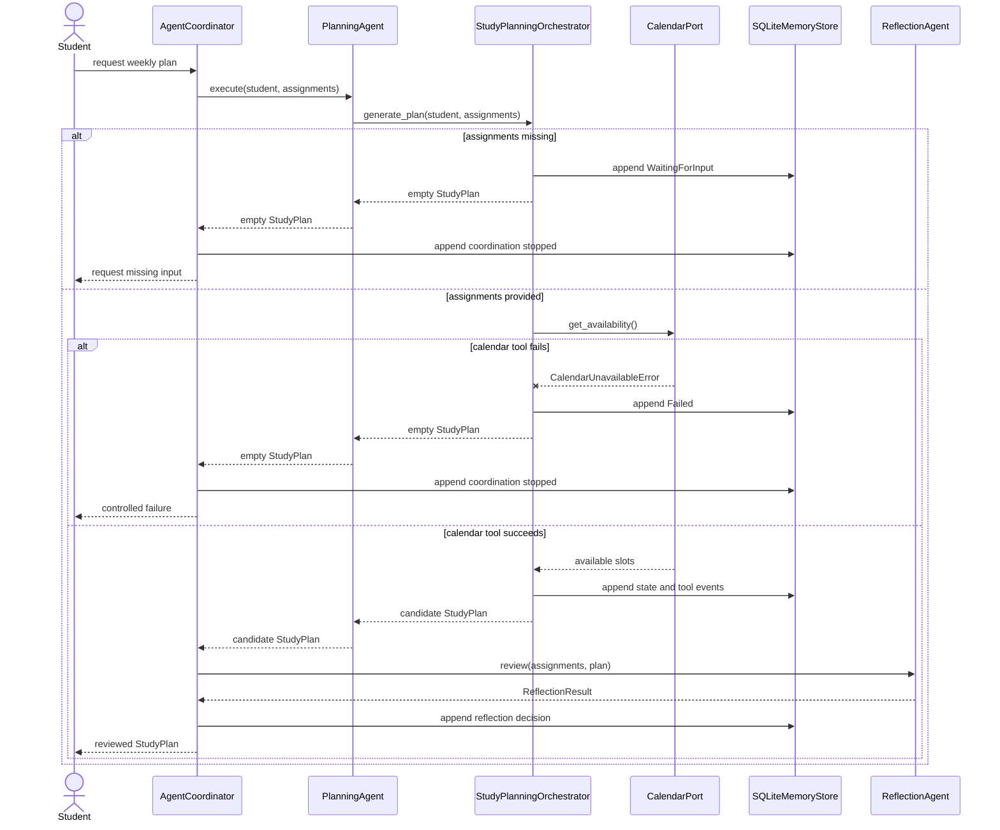

# Week 11 - Agent Interaction Sequence

The sequence records the successful path and makes the fail-fast boundary visible. Time flows downwards; the Mermaid `alt`/`else` branches are mutually exclusive.

## Trace checkpoint
The `REFLECTION CHECK` lines must occur **after** the orchestrator prints `STATE -> Completed`. Neither missing-input nor tool-failure scenarios may print `REFLECTION -> ACCEPTED`.
